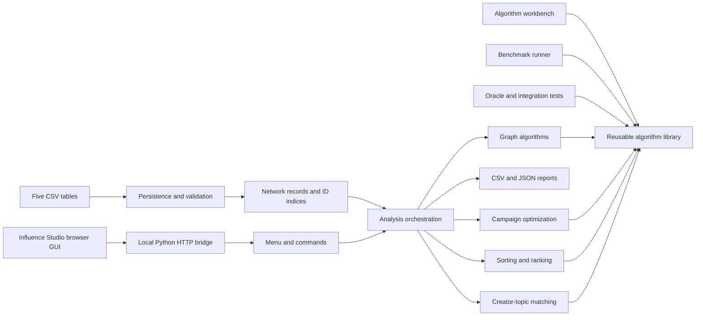

# Design and reusable API

The implementation separates immutable domain inputs, algorithm modules, orchestration, persistence, presentation and experiments. The algorithm engine uses C++17 and the standard library. The optional GUI uses a Python-standard-library HTTP bridge plus local HTML, CSS and JavaScript; assessed algorithms remain in C++. `build/libsocial.a` can be linked into another C++17 program with `-Iinclude`.

## Data model and contracts

`Network` stores typed `User`, `Topic`, `Post`, and `Interaction` records in vectors. `Graph` stores directed `Edge` records with separate delay weights and capacities. `std::map<int,int>` is an ordered tree index from external user IDs to compact vertex indices; this is a domain index, not an implementation of the assessed optimal-BST algorithm. The latter is implemented independently as a DP solver.

The graph algorithms never interpret delay as capacity. Directed propagation uses active links only. MST routines explicitly treat every edge as an undirected candidate; antiparallel edges are parallel candidates and can have different costs. Prim and Kruskal return minimum forests, component counts, chosen edges and total weights, including disconnected inputs. Community detection uses undirected traversal of fast active links, so its communities are explicitly *weak* components. Community IDs follow first encounter order in the user table.

Construct graphs with `Graph(n)` and `add(u,v,weight,capacity)`. Do not mutate the public `n`/`edges` fields into an invalid state. Numeric bounds are enforced by `add`: `|weight| <= 10^9`, `0 <= capacity <= 10^9`, `n <= 100000`. CSV loading permits only positive delays. Algorithms taking a source reject invalid endpoints. Dijkstra rejects any negative weight. Bellman-Ford flags a reachable negative cycle; its distances must not be used when flagged. Floyd-Warshall rejects a negative cycle anywhere in the graph. `path_to` rejects flagged/cyclic predecessor chains. Infinite distances use `social::INF`, not zero.

Matrices are square, dimension at most 256, entries within ±10^6. These bounds keep classical and Strassen intermediate signed arithmetic safe. Odd dimensions are padded to powers of two and cropped on output. Strassen switches to the classical kernel at dimension two; its seven products are actually evaluated for larger matrices. Maximum-subarray inputs are nonempty, at most one million values within ±10^9; returned bounds are half-open. Empty matrices multiply to empty matrices.

Knapsack items have cost 1..10^6 and value 0..10^9. Capacity is 0..10^6. DP keeps a full reconstruction table with at most ten million cells. Backtracking and each branch-and-bound policy accept at most 25 items; branch-and-bound rejects a frontier reaching one million nodes. A rejected solver does not return a partial answer as an optimum. `Selection.items` contains zero-based input indices. Branch-and-bound's `LeastCost` removes the largest profit upper bound first, equivalently the least negative bound in a minimization formulation. Each upper bound is the fractional relaxation rounded upward with integer arithmetic; pruning cannot discard a better integer solution.

`matrix_chain` supports up to 200 matrices with dimensions 1..10000. `lcs` limits its reconstruction table to ten million cells. `optimal_bst` accepts nonnegative finite hit/miss frequencies and up to 300 keys; `q` must have `p.size()+1` entries. It returns weighted comparison cost, including unsuccessful searches; weights need not sum to one. It does not materialize the tree.

N-Queens enumerates all solutions up to n=12, using row-indexed column assignments; n=0 has one empty assignment. Subset sum supports signed values and returns index subsets, including the empty subset when appropriate; at most 22 values and 100,000 output solutions. Identical values at distinct indices remain distinct choices. TSP is a nonnegative directed Held-Karp solver rooted at vertex zero, at most 18 vertices and finite arc costs up to 10^9; `INF` denotes absent arcs. An impossible tour returns `INF`; 0/1 vertex tours cost zero.

Flow uses Ford-Fulkerson with a DFS augmenting-path search and an integer residual matrix, at most 2,000 vertices. Parallel capacities are summed. The result returns flow value, final residual capacities, and a source-side minimum-cut certificate; it does not expose individual flows on antiparallel input arcs. Source and sink must differ. Matching uses augmenting paths, supports at most 10,000 left and 100,000 right vertices, and returns a right index or -1 for each left vertex. Eligibility is based on creator post topics in the domain workflow.

CRT accepts equal-length residue/modulus arrays, pairwise coprime moduli 2..10^9, and a product fitting signed 64-bit arithmetic. Negative residues are normalized; the canonical answer lies in `[0,product)`. The empty system returns zero. Fast exponentiation detects signed overflow and treats exponent zero as one, including base zero.

Huffman returns a codebook plus a bit string represented as ASCII `0`/`1` for inspectability; it is not a compact binary file format. A singleton alphabet uses code `0`. The decoder validates prefix freedom, valid bits and complete terminal codes. All four matchers return sorted overlapping byte positions. The DFA matcher limits the pattern to 100,000 bytes because it builds `(m+1) × 256` transitions. CRT's modular multiplication avoids overflow.

## Extending the project

Public headers document return types and selected constraints. Pure algorithms have no dependency on CSV, CLI, benchmark timing or global randomness. Seeded dataset generation is separate from solving. Sorting takes an optional comparator and `Metrics*`; comparisons and estimated auxiliary payload are exposed. Other solvers expose relevant structural evidence (`Selection.explored`, forest edges, path parents, flow cut, matching assignments).

`src/workbench.cpp` provides fixed regression exercises. `src/domain_workbench.cpp` maps all required families to loaded records with explicit bounded analytical projections for every mandatory algorithm, including syllabus validation problems that do not naturally belong in a social product. Use the mapping table to distinguish integrated analytics from these exercises. The CLI exposes route and text algorithm choice; all other algorithms are selectable through the reusable C++ API.

Persistence validates references before analysis; it supports standard single-line CSV quoting and escapes JSON control characters. Export overwrites the chosen destination. Multi-file loading is not transactional with concurrent writers; datasets are expected to remain unchanged during a load. Export is not atomic and callers should choose a fresh prefix when preserving earlier results matters.

## GUI integration

`make gui` builds the application and launches `gui/server.py`, which serves the bundled static assets on loopback port 8765 and opens a browser. HTTP operations pass validated argument arrays to `build/social_cli` or `build/social_bench`; no shell interpolation or alternative Python implementation of the assessed algorithms is used. The GUI reuses authoritative C++ validation and original CSV/JSON exports. For an arbitrary route under shock, the bridge creates a temporary capacity-adjusted input snapshot before invoking the route command.

Generated/imported datasets and report files are session-scoped temporary files. Imported directories are snapshotted so subsequent source edits do not change the selected dataset. The bridge adds cost, topic-name and bounded graph-display metadata to its HTTP response; download endpoints return the original engine-format reports. Browser graph layout is visualization, not community detection. All community labels and selected candidates come from the engine.

The browser shows up to 102 users and 1,000 active edges before collapsing parallel display lines to the lowest-delay active relationship. It discloses graph sampling; full rankings and paths remain available. The GUI caps inputs at 10,000 users / 12 MB, retains at most 50 datasets and 100 downloadable reports, and runs at most two engine jobs concurrently with a 90-second per-job timeout. Host/Origin and JSON-content checks restrict local browser actions. See [GUI.md](GUI.md) for endpoint behavior, portability, tests and session limits.

## Per-call benchmark instrumentation

Only `social_bench` and `benchmark_memory_tests` link the replacement allocation functions in `src/benchmark_memory.cpp`. The application and reusable library do not override allocation. A new epoch counts outstanding requested C++ new/new[] payload during one callback and records its peak; deallocation of pre-existing or previous-epoch memory cannot underflow the current meter. Aligned/array/sized/nothrow paths share the same bookkeeping. Direct allocation tests validate overlap, reset, alignment and exclusions.

The general runner emits 144 cases across all 36 mandatory variants and four bounded tiers. `social_bench --scenario DIRECTORY BUDGET OUTPUT.csv [shock]` additionally compares the identical active network and candidate pool across route, forest and campaign strategies. Floating solution values are retained independently of legacy checksums. A relative-gap/guarantee label distinguishes exact feasible solutions, feasible density heuristics and fractional relaxations. Measured heap excludes stack, pre-existing inputs, allocator metadata and malloc-only allocation. Instrumented timing includes allocation bookkeeping overhead.
