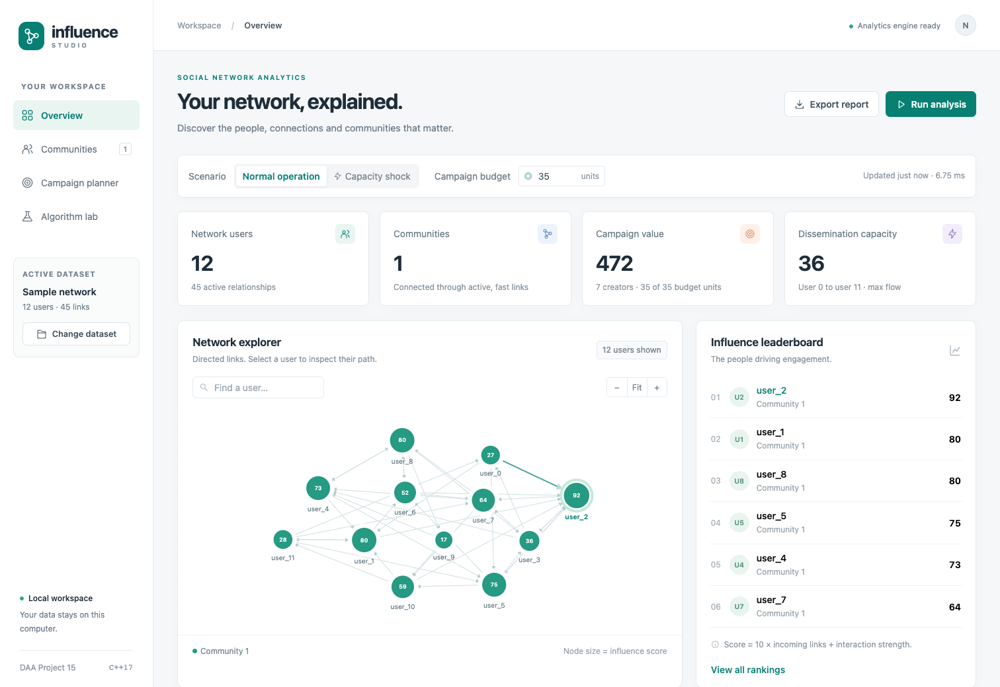

# Influence Studio: graphical interface

The GUI is a local browser dashboard connected to the existing C++17 engine. It uses Python's standard library as the HTTP/subprocess bridge and plain HTML, CSS and JavaScript for the interface. No npm or pip installation is needed to use it.

## Start and stop

From the repository directory:

```sh
make gui
```

This builds the C++ binaries, starts a server at `http://127.0.0.1:8765`, and opens your browser. The sample network is analyzed immediately. Keep the terminal open while using the app; press Ctrl+C in it to stop. On macOS you can also double-click `run_gui.command`.

To choose a port or avoid opening a browser automatically:

```sh
python3 gui/server.py --port 8766 --no-browser
```

Then open `http://127.0.0.1:8766`. The launcher builds the application if the CLI binary is absent. The server binds only to the local loopback interface. It is intended as a single-user local GUI, not a public hosting service.

## macOS folder access

If Terminal prints `getcwd: Operation not permitted`, macOS is denying it access to the Desktop checkout. Allow Terminal to access the Desktop folder in macOS privacy settings, then reopen the terminal; alternatively use a checkout in a directory Terminal can already read. This permission belongs to Terminal and is separate from the application or C++ build. The GUI can still run from an already authorized workspace.

## Dashboard preview



The screenshot uses the bundled synthetic sample. For the campaign detail view, see the [campaign planner screenshot](presentation/assets/GUI_Campaign.png).

## Main workflows

**Overview:** view network metrics, interact with the directed graph and influence leaderboard, inspect a user's score factors and source path, and see the selected campaign. Click a graph node or ranked user to update the spotlight. Search the graph, zoom in/out, or reset with Fit. The All Rankings dialog searches and paginates the complete ranking list.

**Communities:** browse fast-link weak components, search their members and select a member to inspect in Overview. Communities are sorted by size and paginated. Membership uses the same positive-capacity/delay-at-most-5 rule as the CLI.

**Campaign planner:** see every candidate's score and cost, selection status, budget spent/remaining and the maximum creator-topic matching. Change Campaign budget and click Run analysis. Exact optimization remains limited to the top 20 candidates and the same DP table-size limits as the CLI.

**Algorithm lab:** choose Dijkstra, Bellman-Ford or Floyd-Warshall for a pair of external user IDs. Routing uses the currently analyzed scenario, including zero-capacity filtering after a shock. Choose naive, Rabin-Karp, DFA or KMP to match text, including overlapping and empty patterns. Run all syllabus algorithms on the loaded dataset in the workbench, with printed bounds and mappings. **Compare this network** runs identical-input route, infrastructure and campaign strategies and downloads measured per-call heap, time, solution values, exact references and relative gaps. Fractional upper bounds are labeled separately from feasible integer plans. Run/download the full benchmark CSV for small/medium/large/adversarial families. Match output lists at most the first 500 offsets for readability and reports the total count.

**Normal / Capacity shock:** changing the scenario runs a new analysis. The Normal preset sets budget 35; Shock sets budget 10 and divides each capacity by four, rounding down. You can then edit the budget and run again. Rankings remain historical; communities and routing reflect the active scenario. If a request fails, the last successful analysis remains visible with an error message.

**Change dataset:** choose the bundled sample, generate 2..10,000 synthetic users, type a local CSV directory, or select the five CSV files together. Imports use the C++ loader for schema/reference validation. Loaded files are copied into a temporary session snapshot so later edits to the source directory do not silently alter the analyzed dataset. Directory paths may be relative to the repository root or absolute. All five tables must be present, even when some have no data rows.

**Export report:** download CSV or JSON from the latest successful C++ analysis. These downloads use the engine's original report format. The GUI's extra graph-layout and campaign-cost metadata is not added to the original C++ export.

## Session and size limits

Dataset snapshots, generated files and report downloads live in an OS temporary directory and are removed when the GUI stops normally. Download reports you want to keep. A session retains at most 50 datasets and 100 recent downloadable reports. Loading a new dataset does not overwrite source CSV files.

The interactive GUI supports up to 10,000 users and imports totaling at most 12 MB. These limits are separate from the larger CLI limits. The graph shows up to 102 selected users (the highest-ranked 80 plus campaign users and endpoints) and up to 1,000 active relationships before collapsing parallel visual lines to their lowest-delay active edge. Directed arrows indicate propagation direction. When graph data is sampled, the interface discloses the count; all scores, communities, candidates and paths still come from the full network. A selected full-network route may include users omitted from the bounded graph, so the spotlight also shows the complete textual path.

Max-flow remains skipped above 2,000 users and is labeled Not computed. Exact solvers keep the limits documented in `docs/DESIGN.md`. Every engine subprocess has a 90-second timeout; the server allows two concurrent jobs and gives a clear error when busy. Synthetic data is labeled as such; imported datasets are not labeled synthetic automatically.

Requests use argument arrays without shell interpolation. Only predefined static assets are served. Local Host/Origin checks and JSON-only mutation requests prevent cross-origin browser actions. This is a local workstation tool; it does not provide public-user authentication or internet deployment.

## Architecture

```text
Browser (gui/static)
        |
        | local JSON HTTP requests
        v
Python bridge (gui/server.py)
        |
        | subprocess argument arrays
        v
C++ CLI / benchmark runner
        |
        v
Reusable student algorithm library
```

The Python layer handles HTTP, CSV snapshots and display metadata; assessed algorithms execute in C++. For custom route endpoints under shock, the bridge makes a temporary capacity-adjusted CSV snapshot and calls the same C++ routing command. Static assets work offline; there are no remote fonts, scripts, analytics or CDNs.

## Verification

```sh
make test       # original unit/integration suites plus GUI HTTP integration tests
make test-gui   # GUI HTTP tests only
```

`tests/gui_integration.py` uses only Python's standard library and starts its own server on a dynamically assigned port. It exercises real C++ results, all scenario/route/matcher strategies, imports and snapshot isolation, exports, the stress case, workbench, benchmarks, and validation/origin errors.

Optional visual browser checks require Playwright and a browser. Those packages are QA tools only, not app dependencies. Start the GUI, install Playwright outside the repository if desired, then run:

```sh
PLAYWRIGHT_MODULE=/path/to/playwright \
CHROME_PATH='/Applications/Google Chrome.app/Contents/MacOS/Google Chrome' \
node tests/gui_browser.cjs
```

`CHROME_PATH` is optional when Playwright's Chromium is installed. Screenshots, downloaded reports and benchmark fixtures go to ignored `results/test-gui/`. The checks cover desktop/mobile layout, every navigation view, imports, generation, graph interaction, scenario changes, algorithm controls and downloads.


## Presentation and evidence

The GUI-aware [PowerPoint](presentation/Project_15_Presentation.pptx), [PDF report](presentation/Project_15_Presentation_Report.pdf), [editable Word report](presentation/Project_15_Presentation_Report.docx), and [live run sheet](presentation/LIVE_RUN_SHEET.txt) use real screenshots and the verified normal/shock/stress results. [DEMO.md](DEMO.md) provides the GUI-first walkthrough and CLI fallback. The tracked [verification record](../results/GUI_VALIDATION.txt) summarizes executed GUI checks; detailed local downloads and QA logs remain in ignored `results/test-gui/`.


## Acceptance comparisons

`make comparisons` produces reproducible normal/shock/stress CSVs plus an adversarial campaign and a [comparison report](../results/comparisons/REPORT.md). The [acceptance checklist](REQUIREMENTS.md) maps all brief items to their implementations. **Compare this network** in Algorithm lab downloads the equivalent measurements for the active dataset. Unreachable routes are labeled `unreachable` with an empty numeric distance, not a huge finite delay. A missing analytical workspace estimate is not treated as zero total memory; use the measured heap column with its exclusions.
